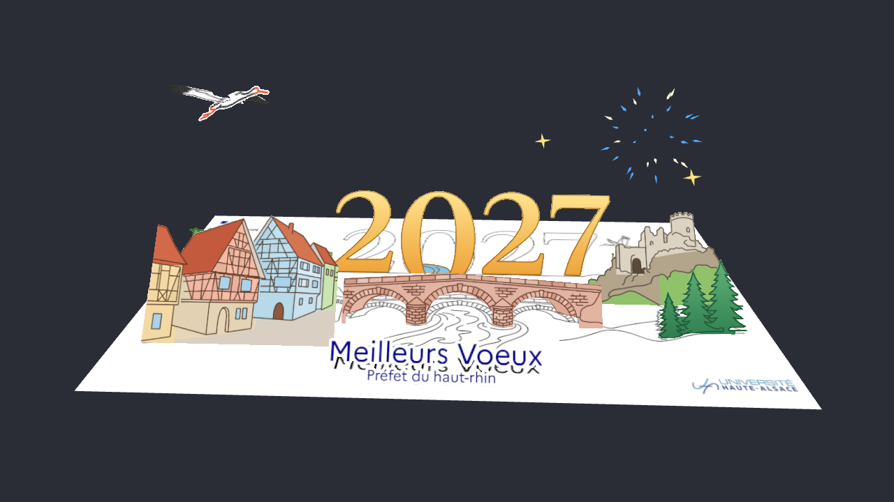

# Carte de vœux 2027 en réalité augmentée

Carte à colorier de la préfecture du Haut-Rhin. Quand on vise la carte imprimée avec un téléphone,
le dessin prend des couleurs et se déplie comme un livre pop-up. Les chiffres 2027 sautent en vague,
des feux d'artifice éclatent au-dessus, et la cigogne s'envole avant de revenir se poser.
L'animation dure 12 secondes et tourne en boucle. Tout se passe dans le navigateur, sans application.

**Site :** https://last64.github.io/CarteDeVoeux/ (ouvrir sur le téléphone, autoriser la caméra, viser la carte)



La vidéo `apercu/apercu-animation.mp4` montre l'animation complète.
Il existe aussi une **version sans feux d'artifice**, où la neige les remplace : voir plus bas et `apercu/apercu-animation-sans-feux.mp4`.

---

## La chaîne de fabrication

```
Dessin (Illustrator)  →  calques PNG  →  Blender (animation)  →  carte.glb  →  page web A-Frame + MindAR  →  GitHub Pages
```

### 1. Le dessin et les calques

- `impression/carte-a-imprimer.png` est la carte à imprimer, à 300 dpi (215 × 105 mm).
  Le bas des deux « 2 » et du « 7 » manquait dans le dessin : il a été redessiné.
  La même correction est appliquée dans `impression/carte2027-corrigee.svg`.
- `blender/calques/` contient les 15 éléments du dessin, découpés et coloriés, en PNG transparents :
  les 4 chiffres, les vignes, les feuilles, le château, le pont, les sapins, les maisons, le texte,
  et la cigogne en 3 morceaux (corps et 2 ailes) pour pouvoir battre des ailes.
  Le fichier `calques.json` donne la position de chaque calque sur la carte, en pixels.

### 2. Blender : `blender/carte_popup.blend`

**Les repères**

- La carte fait **1 m de large** dans Blender, parce que dans MindAR 1 unité = la largeur de la carte.
- La carte est **posée au sol** (plan XY). La vue de dessus (pavé num. 7) montre exactement la carte imprimée.
- La collection *Carte imprimée* sert seulement de repère. Elle est cachée au rendu, donc elle n'est pas exportée.

**Les calques**

- Chaque calque est un plan à la taille exacte de son PNG, placé à sa position sur la carte.
- Son **origine est sur sa charnière**, c'est-à-dire en bas de l'élément.
- Il se lève jusqu'à **45°**, et pas 90° : à 90°, un élément filmé de face est vu par la tranche et disparaît.
- Le matériau est **sans ombre** : nœuds *Light Path > Is Camera Ray* + *Emission*,
  que l'export glTF transforme en `KHR_materials_unlit`. Les couleurs restent donc les mêmes quel que soit l'éclairage.
- La transparence du PNG passe par un nœud *Math > Round*, qui donne une découpe nette (`alphaMode MASK` dans le glTF).

**L'animation** : images 0 à 288, soit 12 s à 24 i/s, avec uniquement des images clés

| Images | Ce qui se passe | Technique |
|---|---|---|
| 0 | La carte apparaît coloriée, à plat | – |
| 8 → 76 | Les éléments se lèvent un par un, de l'arrière vers l'avant | Rotation X de 0° à 45°, interpolation **Back** (rebond) |
| 30 → 270 | Les sapins et les feuilles se balancent | Rotation Y de ± 2 à 3° |
| 60 → 252 | La cigogne s'envole, fait le tour de la scène et se repose | Vide parent *Cigogne* : position, inclinaison à 45°, demi-tour (rotation Y) ; les ailes tournent autour de l'axe du corps |
| 84 et 196 | Vague 2-0-2-7 | Position Z, interpolation **Bounce** |
| 86 → 246 | 7 feux d'artifice (version normale) | Une fusée qui monte, puis une gerbe animée par **clés de forme** (*Base → Explosion → Fin*) |
| 0 → 288 | Neige (version sans feux) | 48 flocons qui descendent en boucle (4 s ou 6 s par chute) en se balançant |
| 70 → 250 | Étoiles qui scintillent | Échelle de 0 à 1 puis 0 |
| 258 → 285 | Tout se replie, puis l'animation recommence | Rotation X de 45° à 0°, interpolation **Back** |

Les courbes se voient dans le *Graph Editor* et la *Dope Sheet*.
Le script `blender/construire_carte.py`, dans l'onglet *Scripting*, reconstruit toute la scène.

**L'export** : *Fichier > Exporter > glTF 2.0*

- Format : **glTF Binary (.glb)** → `assets/carte.glb`
- Inclure : **Renderable Objects**. La carte repère n'est pas exportée.
- Transformation : **+Y Up**
- Animation : mode **Scene**, *Split by Object* décoché. Toute la timeline devient **une seule animation**.
- *Always Sample Animations* coché : les interpolations Back et Bounce sont « cuites » image par image.

**La version sans feux d'artifice**

Si les feux d'artifice ne sont pas autorisés, la collection *Neige (version sans feux)* les remplace.

1. Dans l'Outliner, cliquer sur l'**appareil photo** pour désactiver *Feux d'artifice* et activer *Neige*. L'œil sert seulement à l'affichage dans Blender.
2. Exporter avec les mêmes réglages vers `assets/carte-sans-feux.glb`.
3. Dans `index.html`, remplacer `carte.glb` par `carte-sans-feux.glb`. C'est le seul changement à faire.

Les deux fichiers sont déjà exportés : il suffit de faire l'étape 3 pour changer de version.

### 3. La page web : `index.html`

- **A-Frame 1.7.0** affiche la 3D.
- **MindAR 1.2.5** reconnaît la carte grâce à `assets/targets.mind`.
- **aframe-extras 7.6.0** fournit le composant `animation-mixer`, qui joue l'animation du `.glb`.

Ce sont les mêmes bibliothèques que dans l'exemple du cours.

```html
<a-entity id="carte" mindar-image-target="targetIndex: 0">
  <a-gltf-model src="#carte-popup" rotation="90 0 0" animation-mixer></a-gltf-model>
</a-entity>
```

- `rotation="90 0 0"` : dans Blender, la carte est au sol et les éléments montent vers Z.
  Dans MindAR, la carte est le plan XY et Z sort de la carte vers nous. La rotation de 90° fait correspondre les deux.
- Il n'y a ni échelle ni décalage à régler, parce que la carte fait 1 de large des deux côtés.
- Le petit script en bas de la page relance l'animation depuis le début chaque fois que la carte est retrouvée.
- `targets.mind` est l'image de la carte compilée par le compilateur de MindAR
  (le même que l'outil en ligne https://hiukim.github.io/mind-ar-js-doc/tools/compile).

`apercu.html` montre la même scène **sans caméra** : la carte et le pop-up sur une table virtuelle.
C'est pratique pour tester sur un ordinateur, ou comme solution de secours pendant une présentation.

### 4. La mise en ligne

La caméra ne fonctionne qu'en **https**, d'où GitHub Pages :
*Settings > Pages > Branch : main, dossier / (root) > Save*.

---

## Tester

- **Sur ordinateur** : ouvrir le dossier dans VS Code, puis *clic droit sur `apercu.html` > Open with Live Server*.
  Avec `index.html` et une webcam, on peut viser la carte imprimée ou affichée sur un autre écran.
- **Sur téléphone** : ouvrir le lien GitHub Pages et viser la carte.
  Elle doit être bien éclairée et entièrement visible au début.

## Modifier

- **L'animation** : modifier les images clés dans `carte_popup.blend`, puis réexporter vers `assets/carte.glb` avec les réglages ci-dessus.
- **Le dessin** : recompiler `assets/targets.mind` avec la nouvelle image, puis refaire les calques concernés.

## Questions possibles à l'oral

- **Pourquoi les éléments se lèvent à 45° et pas à 90° ?** À 90°, quand on filme la carte de face, les éléments sont vus par la tranche et deviennent invisibles. À 45°, ils restent visibles de face (à 71 %) comme de biais. La cigogne et les étoiles sont aussi penchées à 45° vers le spectateur.

- **Pourquoi un .glb ?** C'est un seul fichier qui contient la géométrie, les textures et l'animation. Il est léger (1,2 Mo) et lu directement par A-Frame (three.js).
- **Pourquoi des matériaux sans ombre ?** Pour garder les couleurs exactes du coloriage. Ainsi, le rendu ne dépend pas d'une lumière virtuelle qui ne correspond pas à la vraie pièce.
- **Pourquoi l'animation se replie à la fin ?** Pour que la boucle soit invisible : la dernière image est identique à la première (tout à plat).
- **Pourquoi des clés de forme pour les feux d'artifice ?** Une gerbe de 26 étincelles est un seul objet. Animer 2 poids (*Explosion* et *Fin*) au lieu de 26 objets rend le fichier environ 3 fois plus léger.
- **Pourquoi pas de détection des couleurs du coloriage ?** Il faudrait beaucoup de code (shaders) et cela dépend de la lumière. Ici, tout est fait dans Blender, et le coloriage de la personne reste visible sur la carte sous le pop-up.
